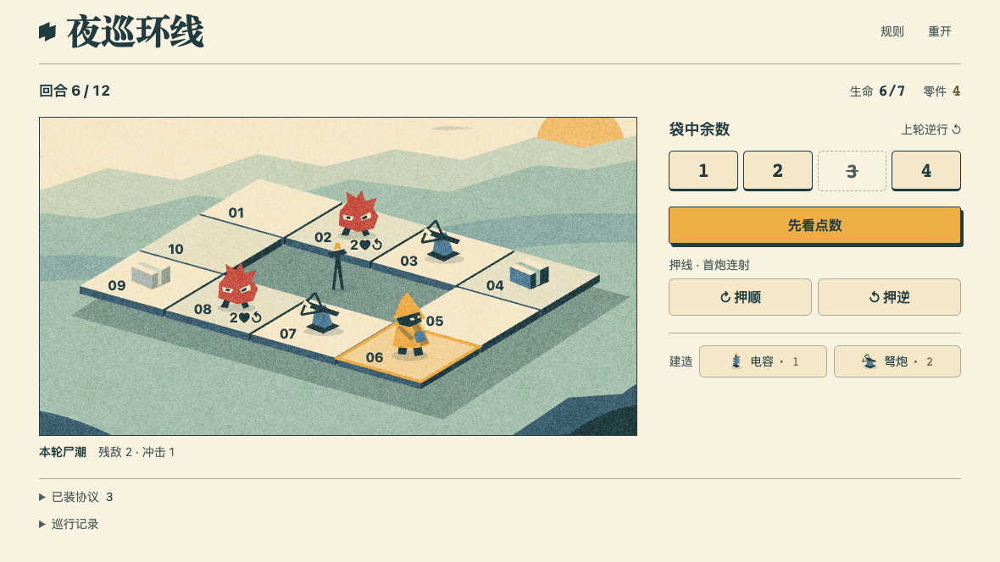

# 纸墨游乐场 · Paper Ink Arcade

一个小型游戏原型合集。每次做一个能玩完的实验，记录玩家做了哪些决定，再判断值不值得继续。



《夜巡环线》A / B 两版均已接入「纸墨」：等距环线、剪影角色与静态纸纹取自共用视觉包，棋子、补给、伤害与可建造位置随对局变化。两版共用同一套画面和战斗系统，区别在步数和选路规则。

## 本地试玩

下载或克隆后，用浏览器打开根目录的 `index.html`，选择游戏或视觉样板。无需安装依赖，也无需构建。

如果更习惯通过 HTTP 访问，在仓库根目录运行：

```sh
python3 -m http.server 8000 --bind 127.0.0.1
```

然后访问 [本地游乐场](http://127.0.0.1:8000/)。

## 仓库导航

| 目录 | 内容 |
| --- | --- |
| [01-dead-circuit](01-dead-circuit/) | **夜巡环线**：十格环线上的骰子生存构筑。[构筑试玩](01-dead-circuit/PLAYTEST.md) · [明袋与押线对照](01-dead-circuit/PLAYTEST-AB.md) |
| [visual/paper-ink](visual/paper-ink/) | **纸墨 0.1**：六色基础色、原创剪影、纸纹和可选 WebGL2 shader。[设计规范与接入](visual/paper-ink/README.md) |

新玩法放进独立的编号目录（如 `02-游戏名/`），在首页登记入口。共用配色与材质放在 `visual/`，不把游戏逻辑放进视觉包。
